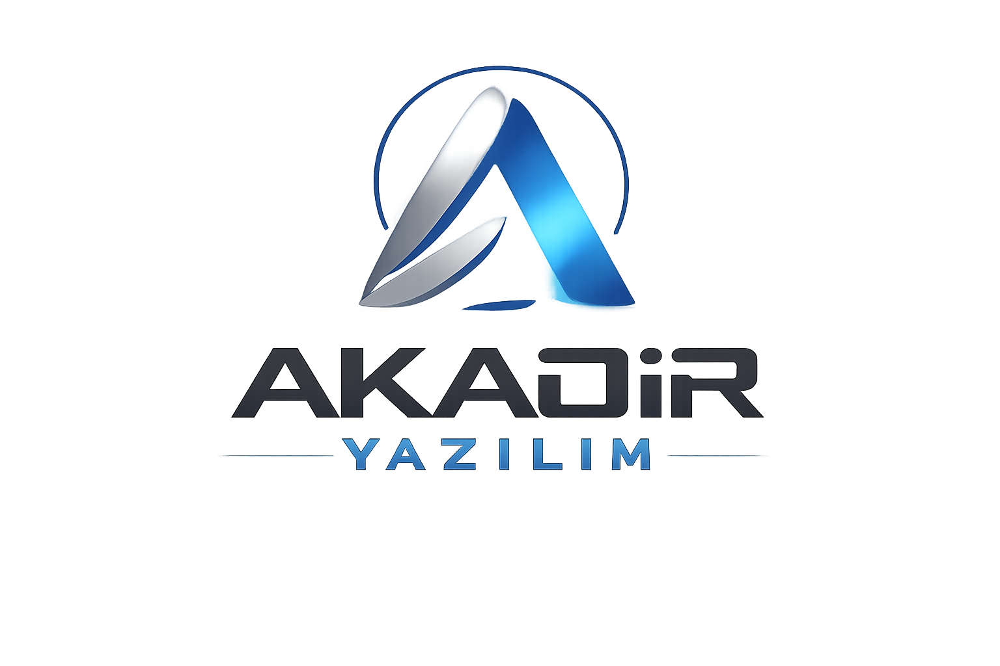

<div align="center">



<br>

</div>

<div align="center">


<div align="center">


<br>


<br><br>

<a href="https://akadiryazilim.gt.tc">

</a>

<a href="https://github.com/AKADIR-YAZILIM">

</a>

</div>

---

# ⚡ AKADİR YAZILIM

<div align="center">

### 🚀 Modern Yazılım • Yapay Zekâ • Dijital Çözümler

**Geleceğin teknolojilerini güçlü kodlarla geliştiriyoruz.**

</div>

---

## 🏢 Hakkımızda

AKADİR YAZILIM; web uygulamaları, özel yazılım sistemleri, yapay zekâ çözümleri ve dijital platformlar geliştiren teknoloji markasıdır.

Amacımız güvenilir, hızlı ve modern yazılımlar üretmektir.

---

## 🚀 Hizmet Alanlarımız

| Alan | Çözümler |
|---|---|
| 🌐 Web | Web siteleri, paneller, e-ticaret |
| 🤖 Yapay Zekâ | AI sistemleri ve otomasyon |
| 📱 Uygulama | Mobil ve masaüstü uygulamalar |
| ☁️ Cloud | Altyapı ve servis çözümleri |
| 🎮 Oyun | Oyun geliştirme projeleri |
| ⚙️ Yazılım | Özel sistem geliştirme |

---

## 💻 Teknoloji Stack

<div align="center">


<br><br>


<br><br>


</div>

---

## 🧠 AKADİR ENGINE

<pre>
while(true)
{
    Learn();
    Create();
    Improve();
    BuildFuture();
}
</pre>

---

## 📊 GitHub İstatistikleri

<div align="center">


</div>

---

## 🔥 Geliştirme Sürecimiz

```
💡 Fikir
 ↓
🎨 Tasarım
 ↓
💻 Kodlama
 ↓
🧪 Test
 ↓
🚀 Yayın
```

---

## 🌟 Değerlerimiz

- 🚀 Yenilikçilik
- 🔒 Güvenlik
- ⚡ Performans
- 🎨 Modern Tasarım
- 💡 Sürekli Gelişim

---

<div align="center">

# ⚡ AKADİR YAZILIM

### Build • Create • Innovate


</div>
